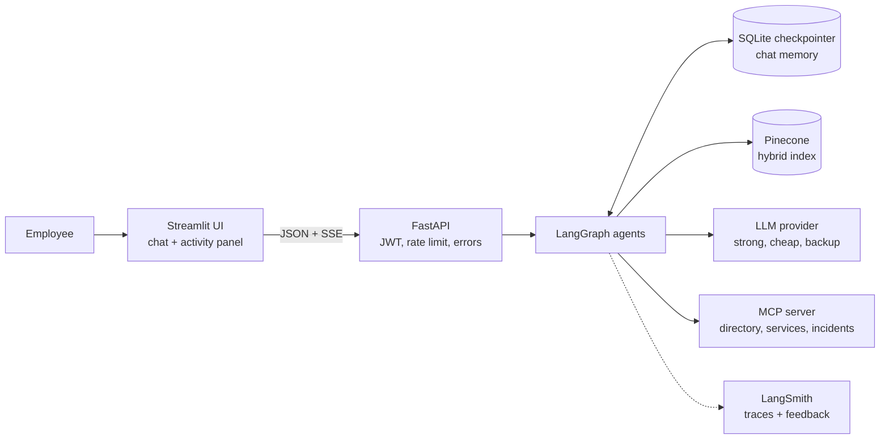
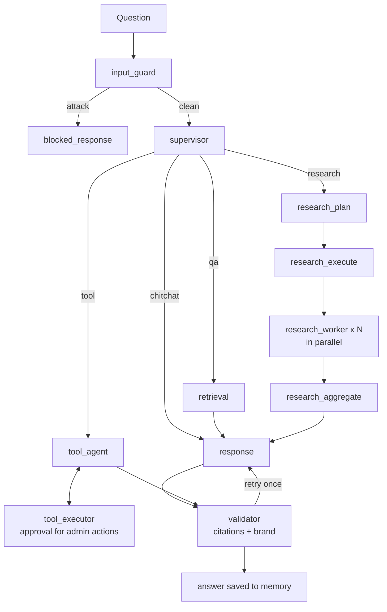

# Commercial Bank Knowledge Assistant

An internal AI assistant for a (fictional) Commercial Bank. Employees ask questions about policies, incident
reports, runbooks, architecture documents, product specs and meeting notes. A team of LangGraph agents answers with
**cited sources**, respects each user's **role**, shows its work live in an **Agent Activity Panel**, and keeps
working when parts of the system fail.

> All documents and people in this repository are fictional mock data created for a technical assessment.

**Demo video:** _add link here_ · **LangSmith project:** `commbank-assistant`

---

## What it does

| Feature | In one sentence |
|---|---|
| Cited answers (RAG) | Hybrid search (meaning + keywords) over Pinecone; every fact is cited like `[POL-SEC-001#4]` and the citations are checked in code. |
| Multi-agent graph | A supervisor routes each question to retrieval, deep research, or tools, then a validator checks the answer. |
| Deep research (RLM) | For "all outages last year"-style questions the model writes a small Python search plan, a sandbox runs it, parallel workers read batches, and code counts the results. |
| Tools + MCP | Knowledge search, a Python analysis tool (counts, timelines), and employee directory, service catalog and incident records from a separate MCP server; admin actions wait for human approval. |
| Roles (RBAC) | Viewer, analyst and admin see different documents and tools. Enforced in code, never by the prompt. |
| Live activity | The UI streams every agent step, tool call, retrieval result, memory update and validation result. |
| Security | Input guard, retrieval guard, spotlighting, brand rules, citation check. See [docs/security.md](docs/security.md). |
| Resilience | Backup LLM, Pinecone circuit breaker with local search fallback, MCP-down handling, tool timeouts, chaos switches. |
| Observability | LangSmith traces for every run and step, plus thumbs up/down feedback attached to the run. |

## Architecture





More diagrams (request sequence, research flow, retrieval pipeline, role matrix): [docs/architecture.md](docs/architecture.md).

## Quick start (Docker)

You need Docker (Docker Desktop or OrbStack) and API keys for OpenAI, Pinecone and LangSmith. Anthropic is optional.

```bash
cp .env.example .env          # then fill in the keys and set a JWT_SECRET
docker compose build
docker compose --profile ingest run --rm ingest   # once: embeds the documents into Pinecone
docker compose up -d
```

Open http://localhost:8501. Stop with `docker compose down`.

## Quick start (local, for development)

```bash
uv sync
cp .env.example .env                                # fill in the keys
uv run python -m scripts.ingest                     # once
uv run python -m mcp_server.server                  # terminal 1
uv run uvicorn app.main:app --reload                # terminal 2
uv run streamlit run ui/streamlit_app.py            # terminal 3
uv run pytest -q                                    # 198 tests, no network needed
```

Handy scripts: `scripts/ask.py` (one question from the terminal), `scripts/chat.py` (multi-turn chat),
`scripts/search.py` (try hybrid search), `scripts/list_documents.py`, `scripts/generate_incidents.py`.

## Demo users

| Username | Password | Role | Can see |
|---|---|---|---|
| `viewer` | `viewer123` | viewer | public + internal documents, document search only |
| `analyst` | `analyst123` | analyst | + confidential documents, deep research, MCP tools |
| `admin` | `admin123` | admin | + restricted documents (e.g. salary bands), admin actions with approval |

These are test accounts for the demo; passwords are stored only as bcrypt hashes in `data/users.yaml`.

## Requirements → where they are

| Requirement from the brief | Where |
|---|---|
| Streamlit chat, multi-turn, streaming | `ui/streamlit_app.py`, `app/api/chat.py` (SSE) |
| Activity panel: node, tool calls, retrieval, memory, validation, final response | `app/graph/streaming.py`, `ui/panel.py` |
| FastAPI, async APIs / retrieval / tools, error handling, structured logs | `app/api/`, `app/services/search.py` (`asyncio.gather`), `app/graph/nodes/tools.py`, `app/api/error_handlers.py`, `app/core/logging.py` |
| LangGraph with supervisor, retrieval, research, response agents | `app/graph/builder.py`, `app/graph/nodes/` |
| RLM: explore catalog, generate Python plan, batches, sub-agents, aggregate | `app/graph/nodes/research.py`, `app/knowledge/catalog.py`, `app/knowledge/sandbox.py` |
| Hybrid search (dense + BM25), Pinecone namespaces + metadata filters, attribution | `app/knowledge/bm25.py`, `app/knowledge/hybrid.py`, `app/services/search.py`, `scripts/ingest.py` |
| Memory across turns | LangGraph checkpointer (`app/main.py`), supervisor rewrites follow-ups |
| Tools: knowledge search, MCP, Python analysis | `app/tools/knowledge_search.py`, `mcp_server/`, `app/tools/python_analysis.py` |
| LangSmith tracing | `app/core/tracing.py`, `@traceable` spans, run metadata in `app/api/chat.py` |
| Prompt injection, input validation, guardrails, brand values | `app/guards/`, `app/graph/nodes/input_guard.py`, [docs/security.md](docs/security.md) |
| Auth (Option A) and RBAC (viewer / analyst / admin) | `app/core/security.py`, `app/core/rbac.py` |
| Token bucket rate limiting | `app/core/ratelimit.py` |
| Graceful failure: LLM, vector DB, MCP, tool timeouts, invalid requests | `app/services/llm.py`, `app/services/resilient_search.py`, `app/services/mcp_client.py`, `app/tools/registry.py` |
| Bonus: human-in-the-loop approval | `app/graph/nodes/tools.py` (`interrupt()`), `POST /chat/resume` |
| Bonus: feedback loop | `app/api/feedback.py`, thumbs in the UI |
| Bonus: Docker Compose | `docker-compose.yml`, `docker/app.Dockerfile` |
| Bonus: multi-agent failure handling | parallel research workers report coverage instead of failing the run |

## Model choice

| Job | Setting | Why |
|---|---|---|
| Supervisor, planner, writer, tool agent | `LLM_STRONG` (default `anthropic:claude-sonnet-5-5`) | Best quality for routing, structured output and cited writing |
| Research workers | `LLM_CHEAP` (default `anthropic:claude-haiku-5-5`) | Many parallel calls; a fast cheap model is enough for structured extraction |
| Backup | `LLM_FALLBACK` | Used automatically when the main model fails; another provider gives real resilience |
| Embeddings | OpenAI `text-embedding-3-small` | Anthropic has no embeddings API; small, cheap and good quality |

Models are configuration, not code: any `anthropic:...` or `openai:...` model can be set in `.env`.
The demo recording uses `openai:gpt-5.4-mini` for all three LLM settings.

## Memory design

- **Short-term (per conversation):** the LangGraph checkpointer saves the whole graph state after every step under
  `"<username>:<thread_id>"`, in SQLite (`data/checkpoints.db`, or a Docker volume). Follow-ups such as
  "Who approves exceptions to *it*?" work because the supervisor sees earlier turns and rewrites the question.
- **Only validated answers are remembered:** the response agent writes a draft; the validator moves it into the
  chat history only after it passes.
- **Per-turn fields are reset** at the start of every question so one turn's search results never leak into the next.
- **Isolation:** thread ids are prefixed with the username, so users cannot read each other's chats.
- Long-term memory across conversations is not implemented (see [docs/assumptions.md](docs/assumptions.md)).

## Chaos switches (for the demo)

Set one in `.env`, restart the API, and watch the Activity Panel:
`CHAOS_LLM_FAIL`, `CHAOS_PINECONE_FAIL`, `CHAOS_MCP_DOWN`, `CHAOS_TOOL_SLOW_MS=15000`, `CHAOS_FAKE_CITATION`.
`GET /health` lists the switches that are on.

## Project layout

```
app/
  api/        HTTP endpoints: auth, chat (SSE), feedback, health, errors, middleware
  core/       settings, users, JWT, roles, rate limit, logging, tracing
  graph/      LangGraph state, prompts, builder, streaming, nodes/
  knowledge/  documents, chunking, BM25, hybrid helpers, catalog, sandbox
  services/   embeddings, Pinecone, search (+ local fallback, breaker), LLM factory, MCP client
  tools/      tool registry, knowledge_search, python_analysis, admin tools
  guards/     injection, citations, brand
mcp_server/   FastMCP server with dummy enterprise data
ui/           Streamlit app, API client, activity panel text
scripts/      ingest, incident generator, ask/chat/search helpers
data/docs/    25 mock documents (Markdown + front matter)
docs/         architecture, security, assumptions and trade-offs
tests/        198 tests with fake LLM, fake search and fake tools
```

## More documents

- [docs/architecture.md](docs/architecture.md): diagrams and design decisions
- [docs/security.md](docs/security.md): threats and controls
- [docs/assumptions.md](docs/assumptions.md): assumptions, trade-offs, known limits, next steps
