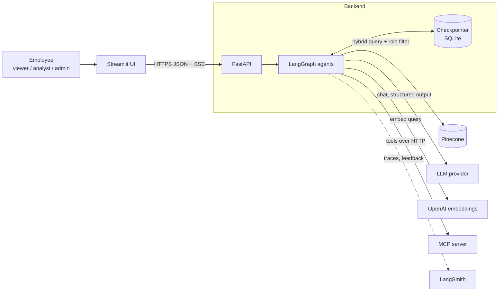
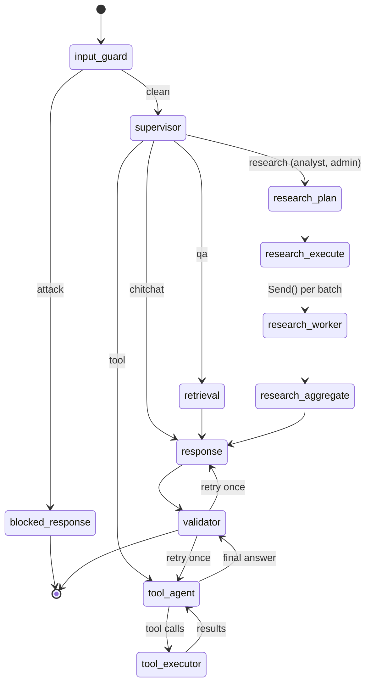
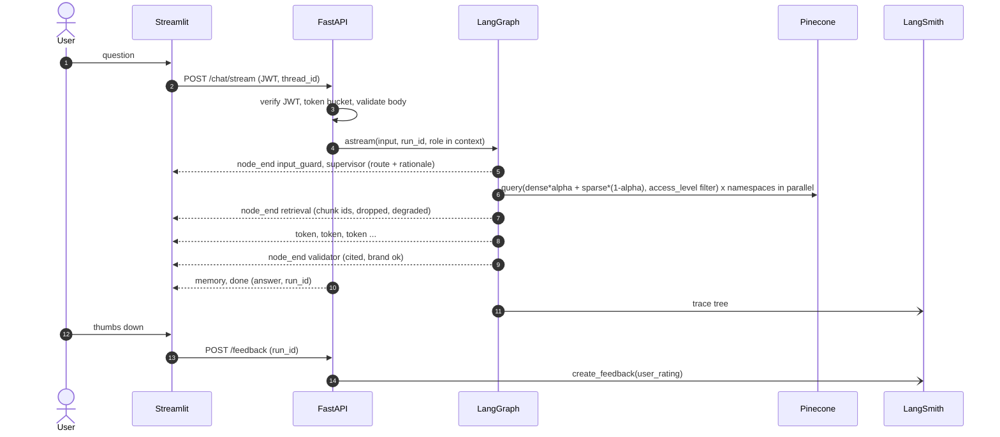
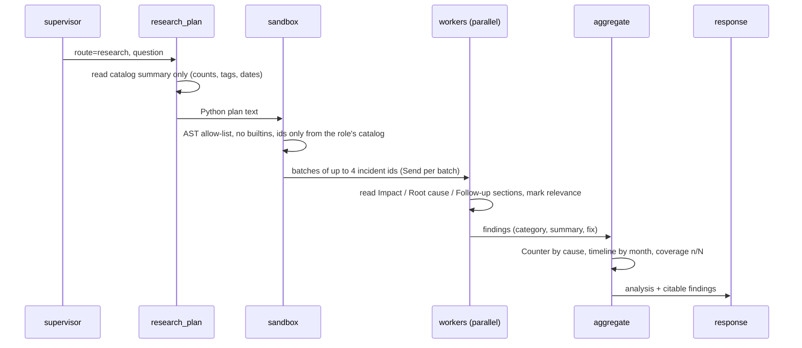
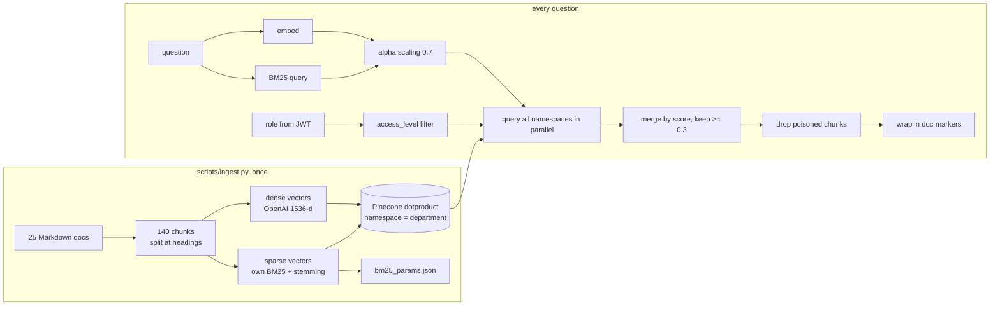
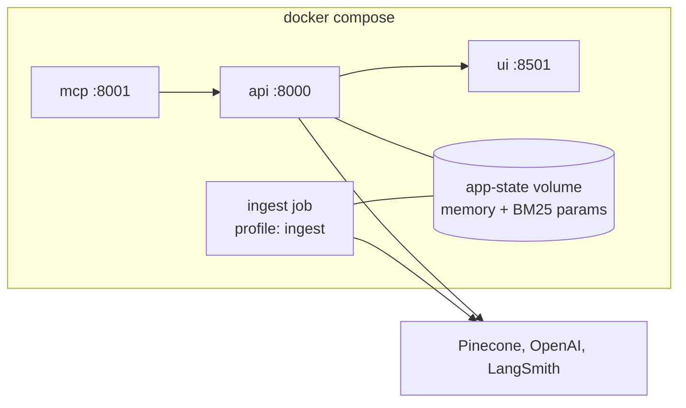

# Architecture

## 1. System context

The user only talks to the UI, and the UI only talks to the API. Login, rate limiting and roles are checked in the
API before any model call. The UI keeps nothing but the JWT and the thread id.

**Design choices**
- *Thin UI, thick backend.* All rules live in the API, so changing the UI cannot bypass them.
- *MCP is a separate process.* That is the point of MCP; it also lets the demo stop it and show graceful degradation.
- *Two model tiers.* A strong model for routing and writing, a cheap one for the many parallel research workers.

## 2. The agent graph

| Node | Job | Uses an LLM? |
|---|---|---|
| `input_guard` | Blocks injection attempts before anything else runs | no |
| `supervisor` | Picks the route, rewrites follow-ups into a full question, gives a rationale | strong (structured output) |
| `retrieval` | Hybrid search with the user's role, drops weak and poisoned chunks | no (embeddings only) |
| `research_plan` | Writes a small Python search plan from a catalog summary | strong |
| `research_execute` | Checks and runs the plan in the sandbox; safe fallback plan if rejected | no |
| `research_worker` | Reads targeted sections of one batch, fills a strict form, judges relevance | cheap, in parallel |
| `research_aggregate` | Counts root causes and builds the timeline in code, reports coverage | no |
| `tool_agent` | Chooses tools (only those the role allows), up to 3 rounds | strong |
| `tool_executor` | Re-checks roles, pauses for approval on admin actions, runs calls in parallel | no |
| `response` | Writes a cited draft from spotlighted passages | strong |
| `validator` | Brand rules + citation check; one retry, then a safe message; saves the answer to memory | no |

**Design choices**
- *Role lives in the runtime context, not in the state.* The model can write to the state; it can never change the
  frozen `RuntimeContext` that carries the user's role.
- *Draft vs. history.* Only validated answers are added to the chat history.
- *Errors are data.* A failed research worker returns "not analysed" instead of raising, so one failure does not
  stop the others (the "butterfly effect" is contained and reported as coverage).

## 3. One request, end to end

## 4. Research (RLM) flow

The planner never reads document bodies; it writes a program that decides what to read. Counting is done in code,
so the numbers are exact. Verified against `data/ground_truth.json`: 12 payment incidents in the last 12 months,
root causes 4 / 3 / 3 / 2.

## 5. Retrieval pipeline

If Pinecone fails or times out, a circuit breaker switches to a local BM25 search over the same chunks with the same
role filter, and the answer says results may be less complete.

## 6. Roles

| Capability | Viewer | Analyst | Admin | Enforced in |
|---|:-:|:-:|:-:|---|
| Chat, memory | ✅ | ✅ | ✅ | `app/api/chat.py` |
| `public` + `internal` documents | ✅ | ✅ | ✅ | Pinecone filter, `app/knowledge/hybrid.py` |
| `confidential` documents | ❌ | ✅ | ✅ | same |
| `restricted` documents | ❌ | ❌ | ✅ | same |
| Deep research route | ❌ downgraded to Q&A | ✅ | ✅ | `app/graph/nodes/supervisor.py` |
| `knowledge_search` tool | ✅ | ✅ | ✅ | `app/core/rbac.py` + registry |
| `python_analysis` tool | ❌ | ✅ | ✅ | same |
| MCP tools | ❌ | ✅ | ✅ | same |
| Admin tools (purge, re-index) | ❌ | ❌ | ✅ + human approval | same + `interrupt()` |

## 7. Deployment

One image runs as three services. Health checks enforce the start order mcp → api → ui. Secrets come from `.env`
at runtime and are never inside the image.
